<div align="center">



# Pipeline Claude

**Une configuration Claude Code où le modèle principal pense et vérifie, et où des sous-agents font le gros du travail.**


</div>

## Sommaire

[Principe](#le-principe-en-30-secondes) · [Schéma](#schéma) · [Agents](#les-agents) · [Modes d'effort](#modes-deffort) · [Déclencheurs](#les-5-déclencheurs-darchitecte) · [Règles](#-règles-clés) · [Dépôt](#-contenu-du-dépôt) · [Installer](#-installer) · [Historique](#historique)

## Le principe en 30 secondes

- **Sonnet 5.5** est le modèle principal, en effort medium. Il conçoit, tranche et vérifie.
- La **lecture, l'écriture de code décidé et les tests** sont déléguées à de petits agents (Haiku ou Sonnet), moins chers.
- **Opus** n'intervient que par l'agent `architecte`, à des moments précis, pas à chaque étape.
- Le contexte reste court : un fichier `SUIVI.md` porte l'état courant, réécrit à chaque étape.
- Les chiffres de coût cités dans `CLAUDE.md` sont des mesures faites sur un usage personnel, pas des garanties.

## Schéma

<p align="center"></p>

## Les agents

| Agent | Modèle | Rôle | Quand l'appeler |
|---|---|---|---|
| `lecteur` | Haiku | Lecture seule, rapport court | 3 fichiers ou ~300 lignes et plus |
| `executant` | Sonnet | Écrit du code déjà conçu, diff minimal | Consigne précise disponible |
| `executant-ui` | Sonnet | Code d'interface web, skills de design préchargés | Pages, CSS, composants, textes visibles |
| `testeur` | Haiku | Lance tests, lint, builds, captures | Sortie longue ; ne modifie rien |
| `chercheur` | Sonnet | Recherche web avec URL et licences | Toute recherche web |
| `architecte` | Opus | Jugement dur, conception | Aux 5 déclencheurs ci-dessous |
| `chasseur-erreurs` | Sonnet | Erreurs silencieuses Python/Qt/JS | Sur demande |
| `securite-web` | Sonnet | Secrets, XSS, CSP avant mise en ligne | Sur demande |
| `seo` | Sonnet | Audit du référencement technique | Sur demande |

## Modes d'effort

| Mode | Quand |
|---|---|
| **medium** | Par défaut : questions, code ciblé, corrections |
| **high** | Seulement sur demande explicite |
| **ultracode** | Problèmes très complexes : architecture, première maquette, gros chantier multi-fichiers |

Changer de mode ou de modèle en cours de conversation recrée le cache : mieux vaut le faire tôt, ou ouvrir une nouvelle conversation.

## Les 5 déclencheurs d'architecte

1. Un test échoue encore après 2 corrections.
2. Une liste de « doutes sérieux » ou de points « non vérifiés » : le plus important lui est confié avant le rapport.
3. Des fichiers « non lus » dont dépend la conclusion : les lire avant de conclure, ou le dire en tête du rapport.
4. Aucun progrès sur 2 points d'étape, ou la même erreur qui revient.
5. Contradiction entre test et doc, ou module difficile à concevoir.

Sans déclencheur, Sonnet travaille seul.

## 📏 Règles clés

- **Délégation** : le fil principal conçoit et vérifie ; lecture, écriture et tests passent par les agents.
- **Contexte court** : compaction automatique à 150 000 tokens, sorties longues coupées, rapports d'agents courts.
- **`SUIVI.md`** : état courant uniquement, réécrit (pas complété) avant chaque compte rendu.
- **Maquette avant code** : pour une interface, la première maquette est faite en Opus ultracode, et le code doit lui ressembler.
- **Interdit de contourner** : si un test ne passe qu'avec un cas spécial, on laisse le test rouge et on appelle `architecte` ou on demande.

## 🗂️ Contenu du dépôt

<p align="center"></p>

```
CLAUDE.md              consignes globales (effort, délégation, contexte, maquettes)
settings.modele.json   modèle de réglages, à adapter
agents/                les sous-agents du tableau ci-dessus
hooks/                 scripts de garde (pause longue, taille de CLAUDE.md, conso, fichiers protégés)
skills/                skills (maquettes, Qt, publication de dépôt, ménage de CLAUDE.md...)
docs/                  références, registre de configuration, point mensuel
routines/              routines planifiées (point mensuel)
outils/                scripts PowerShell (inventaire, point mensuel)
```

## 🚀 Installer

1. Copier `CLAUDE.md`, `agents/`, `hooks/`, `skills/` et `docs/` vers `~/.claude/`.
2. Partir de `settings.modele.json` pour créer `~/.claude/settings.json` et y adapter les chemins des hooks.
3. Si tu utilises le skill `publier-repo`, créer `mots-interdits.txt` (un mot privé par ligne, hors dépôt) à côté de `skills/publier-repo/scan.sh`.

`CLAUDE.md` est écrit à la première personne pour un usage personnel : relis-le et adapte-le avant de l'adopter.

## Historique

Une première version associait Claude à Codex. Elle est archivée en local et a été retirée le 22/10/2026, quand l'abonnement OpenAI s'est arrêté. La pipeline fonctionne depuis avec Claude seul.

---

<div align="center">

Fait avec [Claude Code](https://claude.com/claude-code)

</div>

---

Projet communautaire, non affilié à Anthropic. « Claude » et son logo sont des marques d'Anthropic ; le tracé du logo vient de [Simple Icons](https://github.com/simple-icons/simple-icons) (CC0).
